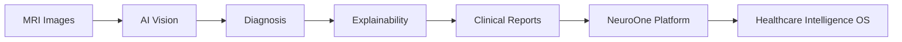
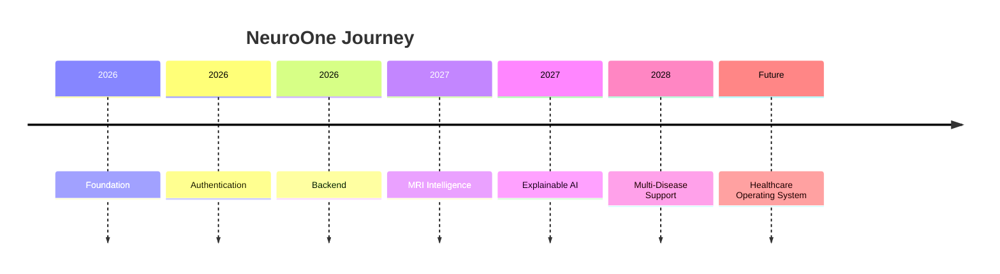

<div align="center">


<p>


</p>

</div>

---

# ✦ The Vision

> **NeuroOne** isn't just another medical AI project.

It is an attempt to build a modular intelligence platform capable of assisting clinicians, researchers and patients through explainable artificial intelligence.

Today it starts with **MRI-based neurodegenerative disease analysis**.

Tomorrow it grows into a complete **Healthcare Intelligence Platform**.

<p align="center">

</p>

# ✦ Ecosystem

<div align="center">


</div>

---

# ✦ Platform Evolution



---

# ✦ System Architecture

<p align="center">

```text
                ┌───────────────────────────────┐
                │        NeuroOne Core          │
                └──────────────┬────────────────┘
                               │
      ┌────────────────────────┼────────────────────────┐
      │                        │                        │
 AI Services              Backend APIs          Authentication
      │                        │                        │
      └──────────────┬─────────┴──────────┬─────────────┘
                     │                    │
               PostgreSQL             Medical AI
                     │                    │
                     └───────────┬────────┘
                                 │
                          Doctor Dashboard
```

</p>

---

# ✦ Current Development

<div align="center">

| Module | Progress | What that actually means |
|:--|:--:|:--|
| 🔐 Authentication | 🟢 Complete | Login, JWT, an emailed OTP second factor (on by default, mandatory in production), purpose-scoped codes, password reset, and rate-limited auth endpoints. Accounts are admin-provisioned; there is no self-registration. |
| ⚙️ Backend APIs | 🟢 Complete | 36 endpoints across auth, patients, visits, symptoms, scans, analyses, reports and triage. 523 tests, run in CI (plus 12 Postgres-marked tests, CI-only). |
| 🧠 AI Pipeline | 🟡 Every seam has a live path; corpus content pending review | Orchestrator, ranking, trend detection and the output contract are real and enforced. Reasoning can run against a live model (`AI_PROVIDER=live-llm`), and literature retrieval can run against a curated, Postgres full-text-searched corpus (`AI_RETRIEVAL_PROVIDER=corpus`, [ADR-007](docs/decisions/ADR-007-curated-retrieval-corpus.md)) -- but both default to mock, and `corpus` has no reviewed content yet, so no environment can run live retrieval yet. MRI staging can run against a general-purpose vision model (`AI_STAGING_PROVIDER=live-vision`, [ADR-008](docs/decisions/ADR-008-live-vision-staging.md)) that reads one 2D slice -- not a validated radiology classifier. All three default to mock. Every analysis states which parts were simulated. |
| 🖥️ Dashboard | 🟢 Connected to the API | A triage queue ranked by `GET /triage`, patient records, new-patient intake, follow-up visits with symptoms and a scan, analysis runs, clinician sign-off and PDF report download, all against real endpoints. Lint, typecheck, tests and build run in CI. |
| 📊 Explainable AI | 🟢 In the API and the UI | The patient record renders ranked differentials with supporting and contradicting findings and their citations, under a provenance line stating which parts of the analysis were simulated. |
| ☁️ Deployment | 🟡 Partial | Compose runs Postgres, applies migrations, then starts the API with scans on a named volume. OTP codes are logged to the API container by default (`OTP_DELIVERY=console`); set `OTP_DELIVERY=email` plus `GMAIL_ADDRESS`/`GMAIL_APP_PASSWORD` on the host to email them. The frontend runs in Compose too, proxying `/api/v1` to the API. |

</div>

> **Status, stated plainly.** The backend implements the full clinical journey and is
> tested, and the frontend drives that journey against it. A curated, real literature
> retrieval corpus now has a live code path (ADR-007), but no reviewed content yet, so
> it is not enabled anywhere. MRI staging has a live path through a general vision model
> (ADR-008), which is a demo of the seam, not a validated imaging model.
> NeuroOne is not clinically validated, is not a diagnostic device, and assists
> clinicians rather than diagnosing. Demo data is synthetic. See
> [`reports/PROGRESS_REPORT.md`](reports/PROGRESS_REPORT.md) for the backend detail
> (written before the frontend was connected) and [`docs/decisions/`](docs/decisions/)
> for the decisions behind it.

---

# ✦ Repository

```text
NeuroOne/
├── backend/
│   ├── app/
│   │   ├── api/
│   │   │   ├── v1/          # auth, admin, patients, visits, analyses, reports, triage
│   │   │   ├── dependencies.py
│   │   │   └── router.py
│   │   ├── core/            # config, database, security
│   │   ├── models/          # SQLAlchemy: user, patient, visit, symptom, scan, analysis, report
│   │   ├── schemas/         # Pydantic wire contracts
│   │   ├── services/
│   │   ├── repositories/
│   │   ├── ai/              # orchestrator, context, ranking, trends, providers/, corpus/
│   │   ├── reports/         # PDF rendering
│   │   ├── utils/
│   │   └── main.py
│   ├── alembic/versions/    # 13 migrations
│   ├── tests/               # 400 tests
│   ├── Dockerfile
│   └── requirements.txt
├── frontend/
│   ├── src/                 # the application
│   │   ├── app/
│   │   ├── components/
│   │   ├── hooks/
│   │   └── lib/
│   └── web-page/            # parked design reference, not a build target
├── docs/
│   ├── decisions/           # ADR-001 .. ADR-006
│   ├── PRD.md, TRD.md, APP-FLOW.md, NEUROONE-MVP-SCOPE.md
│   └── REPORT-01D-frontend-checklist.md
├── reports/                 # PROGRESS_REPORT.md and generated documents
├── scripts/                 # bootstrap_admin, seed_demo_case, dump_backend_routes
├── backend-routes.json      # OpenAPI dump, regenerate with scripts/dump_backend_routes.py
├── docker-compose.yml
├── README.md
└── LICENSE
```

To run the stack locally (start/stop, logs, OTP codes, DB shell), see the
[Docker cheat sheet](docs/DOCKER-CHEATSHEET.md).

---

# ✦ Design Principles

- 🧠 AI First
- 🔒 Privacy by Design
- ⚡ Fast & Modular
- 📈 Scalable Architecture
- 🩺 Built for Real Clinical Workflows


---

# ✦ Roadmap



---

<div align="center">

### Building the Future of Medical Intelligence


</div>
