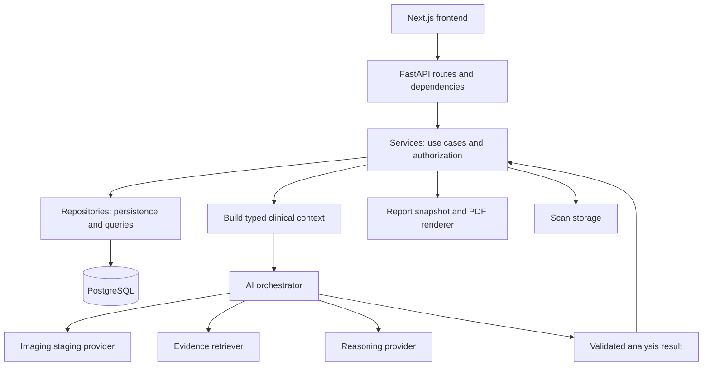
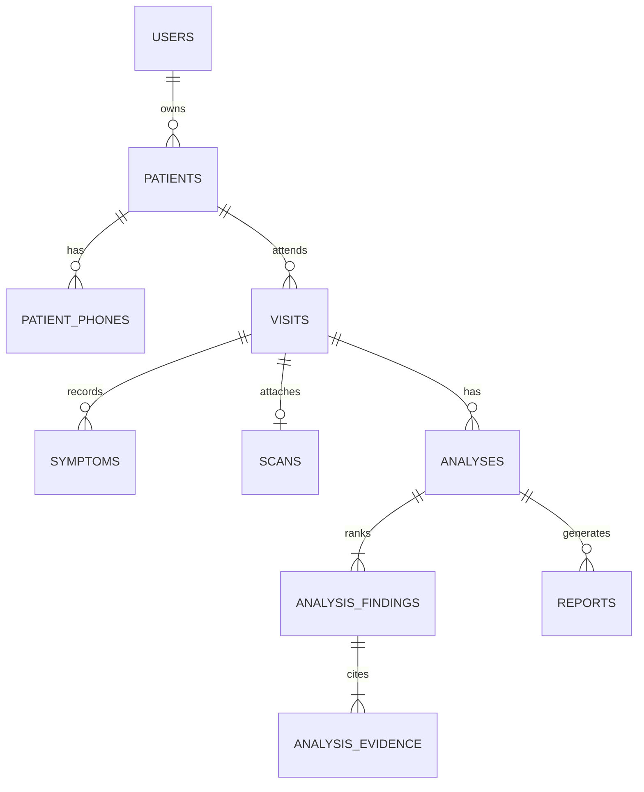

# NeuroONE project handbook

Audit date: **2026-09-13**, AI pipeline refreshed **2026-10-12**. Implementation baseline: **`c336492`** for the AI pipeline and every count (sections 2, 5–9, 11, 14–17, 19); **`a01ae83`** for everything else. Audience: you and your team preparing to explain the project to your professor.

For evidence and unresolved differences, use [AUDIT.md](AUDIT.md). For spoken explanations, use [PROFESSOR-PRESENTATION.md](PROFESSOR-PRESENTATION.md).

## Contents

1. [Product and purpose](#1-product-and-purpose)
2. [Requirements and scope](#2-requirements-and-scope)
3. [The complete user journey](#3-the-complete-user-journey)
4. [System architecture](#4-system-architecture)
5. [Technology stack](#5-technology-stack)
6. [Domain and database](#6-domain-and-database)
7. [API and typed contracts](#7-api-and-typed-contracts)
8. [AI pipeline](#8-ai-pipeline)
9. [What the three providers actually do](#9-what-the-three-providers-actually-do)
10. [Early detection and trends](#10-early-detection-and-trends)
11. [Ranking, uncertainty and provenance](#11-ranking-uncertainty-and-provenance)
12. [Authentication and authorization](#12-authentication-and-authorization)
13. [Reports and snapshots](#13-reports-and-snapshots)
14. [Architectural decisions](#14-architectural-decisions)
15. [Progress and remaining work](#15-progress-and-remaining-work)
16. [Tests and what they prove](#16-tests-and-what-they-prove)
17. [Repository map and configuration](#17-repository-map-and-configuration)
18. [Graphify and project memory](#18-graphify-and-project-memory)
19. [Glossary and recall exercises](#19-glossary-and-recall-exercises)

## 1. Product and purpose

NeuroONE is a **clinical decision-support platform for neurological case evaluation**. Its product design combines MRI scan intake, structured clinical information, patient history and literature-supported reasoning. The clinician receives a ranked set of possible conditions with supporting and contradicting findings, explanations and citations.

The project addresses the difficulty of correlating clinical information over time and keeping an explanation connected to its evidence. Its early-detection narrative is a product ambition. The current demo demonstrates a software workflow for organizing and reviewing signals. It does not establish that a trained model detects disease early in real patients.

The primary user is a **clinician** who manages patients and visits. An **administrator** provisions accounts. The receptionist role, biomarkers and automated treatment decisions are not implemented MVP features.

The governing safety boundary is practical: a machine-generated possibility needs human interpretation. Output must not become an autonomous diagnosis. Sign-off before report creation is one enforcement mechanism; it is not a substitute for clinical validation.

**Say aloud:** “We built a system that helps a clinician review structured information and trace the reasoning. We have not demonstrated clinical diagnostic accuracy.”

Sources: [PRD §1–§4 and §7](../PRD.md), [MVP purpose and early-detection design](../NEUROONE-MVP-SCOPE.md), [ADR-006](../decisions/ADR-006-mri-primary-with-symptoms-as-context.md).

## 2. Requirements and scope

| Requirement | What the product asks for | Current implementation qualification |
|---|---|---|
| FR-01 Authentication | Secure login, hashed passwords, JWTs and protected access | Password login, backend-enforced OTP by default, reset and admin provisioning exist. OTP and rate-limit state remain process-local. |
| FR-02 Patient management | Create, retrieve and update patients, associated with cases | Authorized CRUD, search and soft deletion exist. Frontend consumers exist. |
| FR-03 Clinical input | Symptoms, duration, severity, observations, history and additional case information | Both intakes capture every `SymptomCreate` field (name, severity, onset, duration, observation) through one shared symptom card, and send symptoms inline with the visit (HB-06). |
| FR-04 Differential diagnosis | Ranked possibilities with uncertainty and reasoning | Enforced structured output and likelihood bands. A scanned visit's stage estimate is pinned first, and an analysis that loses it fails with `ai_stage_missing`. |
| FR-05 Literature retrieval | Trusted literature with preserved metadata | Two retrievers: the simulated fixture corpus (default) and a curated PostgreSQL full-text retriever (`AI_RETRIEVAL_PROVIDER=corpus`). The curated corpus holds no reviewed content yet, so it cannot return evidence. |
| FR-06 Explainability | Patient findings, reasoning, evidence and citations | Backend returns them and current UI renders them. Mock imaging region values are not scientific attributions. |
| FR-07 Report | Clinical information, findings, citations, disclaimer and review details | PDF creation is gated by sign-off. The PDF names the reviewer and sign-off time (HB-05), and its clinical inputs come from the analysis's own context snapshot (HB-12). |
| FR-08 Scan intake and staging | Scan per visit, retention, staging and provenance | Scan intake/storage, mock staging and an opt-in live vision stager exist. The live stager reads one rendered 2D slice through a general vision model; it is not a validated radiology classifier. |

MRI became in scope through accepted ADR-006 and revised PRD text. APP-FLOW now matches: it describes scan intake, staging, the triage dashboard and the sign-off gate, and its V1 boundary no longer excludes MRI (HB-02).

Hard exclusions remain uploaded diagnostic-report analysis, autonomous diagnosis and automated treatment decisions. Biomarkers and a receptionist role remain deferred. Proposed retrieval work does not authorize widening those exclusions.

Sources: [PRD FR-01–FR-08](../PRD.md), [APP-FLOW §10](../APP-FLOW.md), [symptom schemas](../../backend/app/schemas/symptom.py), [new intake](../../frontend/src/app/dashboard/upload/page.tsx), [follow-up form](../../frontend/src/app/dashboard/patients/[id]/visits/new/page.tsx).

## 3. The complete user journey

Current PRD §8 acceptance journey:

```text
Login → Patient → Visit (Scan + Symptoms) → AI Analysis
      → Ranked Differential + Evidence → Clinician Review & Sign-off → PDF Report
```

The dashboard adds a triage queue before patient selection. The older APP-FLOW uses “Case” for the clinical encounter. The implemented domain calls it **Visit**. A patient is the person; a visit is their clinical encounter at a point in time.

| Stage | User action | System action |
|---|---|---|
| Login | Enter account credentials | Validate credentials, issue JWT, load `/auth/me` |
| Dashboard | Review queue | Retrieve authorized patients and latest analysis-derived flags |
| Patient | Choose existing patient or create demographics | Persist patient linked to a clinician |
| Visit | Record complaint/history and symptoms, optionally attach scan | Persist encounter and inline symptoms; upload file separately |
| Analysis | Run pipeline | Authorize, read history, build context, stage scans if present, retrieve, reason, validate, persist |
| Findings | Open ranked candidates | Display likelihood, explanation, supporting/contradicting findings, history references and citations |
| Review | Select sign-off | Record reviewing user's id and timestamp on analysis |
| Report | Download | Reuse or create report snapshot, then fetch protected PDF bytes |

The scan is a primary product input but optional in the current backend. Symptoms-only analysis is supported when there is matching evidence. A visit with no scan and no useful structured or complaint input can return `rag_no_evidence`.

The frontend new-patient intake performs multiple requests: patient, visit with its symptoms, optional scan, analysis. These do not form one database transaction. An analysis failure preserves previously saved records. Both intake forms remember which steps landed, so a retry continues from the failed step without creating a second patient, visit or scan. That memory is in the page, so a browser refresh loses it (HB-07).

**Recall:** Why is “saved successfully” different from “analysis succeeded”? Because patient and visit persistence happens before a separate analysis request.

Sources: [PRD §8](../PRD.md), [APP-FLOW](../APP-FLOW.md), [endpoint client](../../frontend/src/lib/endpoints.ts), [intake](../../frontend/src/app/dashboard/upload/page.tsx), [follow-up](../../frontend/src/app/dashboard/patients/[id]/visits/new/page.tsx), [patient analysis page](../../frontend/src/app/dashboard/patients/[id]/page.tsx).

## 4. System architecture



| Layer | Responsibility | Example |
|---|---|---|
| Client | Forms, screens, API calls and loading/error states | Patient detail and findings components |
| API | HTTP routing, validation, auth dependencies, response serialization | `POST /visits/{id}/analyses` |
| Service | Business decisions and coordination | Analysis service authorizes visit, loads history, runs pipeline and persists result |
| Repository | Database queries and transactional persistence | Analysis repository creates findings/evidence and changes visit status together |
| Model | Stored entity definition | Visit, analysis finding, evidence |
| Schema | Shape and constraints of input/output | DiagnosisCandidate and VisitCreate |

The orchestrator has no database session. It accepts typed context and returns typed output. The context builder is the limited exception that reads already-loaded ORM attributes, without querying. Persistence belongs to the service/repository path.

That separation lets a test replace a failing provider without needing a real model or literature service. It also means swapping a provider should not require replacing the UI, report renderer or database contract.

Observed transaction convention: generic repositories commit and roll back; specialized repositories group particular entity graphs into one transaction. The agent contract asks for an explicit transaction-ownership ADR before a multi-repository use case, but a dedicated decision establishing that general convention was not found. Describe the actual behavior and carry the documentation gap forward.

Sources: [TRD §1 and §4](../TRD.md), [dependency wiring](../../backend/app/api/dependencies.py), [analysis service](../../backend/app/services/analysis_service.py), [base repository](../../backend/app/repositories/base_repository.py), [analysis repository](../../backend/app/repositories/analysis_repository.py).

## 5. Technology stack

| Technology | Role in this project | What to say if asked why |
|---|---|---|
| Python / FastAPI | Backend routes and request handling | Fits the Python AI ecosystem and typed HTTP APIs |
| Pydantic 2 | Validate request/response and AI contracts | A model response must satisfy an explicit structure before use |
| SQLAlchemy | ORM and database queries | Maps domain entities to relational persistence |
| Alembic | Versioned schema changes | Records how the database evolves with the code |
| PostgreSQL | Application database | UUIDs, relationships, constraints, JSONB and supported production schema |
| Passlib / bcrypt_sha256 | Password hashing | Store a verification hash instead of a plaintext password |
| python-jose / JWT | Signed, expiring access tokens | Protected requests can authenticate a token |
| httpx | Live LLM and vision HTTP transport | Uses an OpenAI-compatible wire format without a vendor SDK |
| PostgreSQL full-text search | Curated corpus retrieval (`tsvector` + GIN index) | Small reviewed corpus; lexical search is explainable and needs no extension or embedding call |
| nibabel / pydicom / Pillow / NumPy | Render a scan to one greyscale PNG slice for the vision stager | Read NIfTI/DICOM pixels without forwarding headers; re-encoding drops EXIF |
| ReportLab | PDF rendering | Generates a PDF from a typed snapshot without browser printing |
| Next.js 14 / React 18 / TypeScript | Actual frontend | Routes, components and typed API consumption |
| Tailwind CSS | UI styling | Shared tokens and reusable primitives |
| React Hook Form / Zod | Client form validation | Immediate feedback before sending a request |
| Axios | Frontend HTTP client | Token header, shared base URL and controlled error handling |
| pytest / Vitest / Testing Library | Backend and frontend tests | Deterministic service/contract tests and mocked component workflows |
| Docker Compose | Local API/database definition | Useful packaging, with unresolved configuration and scan-storage gaps |

The repository also uses Three.js/React Three Fiber and motion libraries for landing-page presentation. Those visuals do not prove MRI inference works.

PyTorch, ADNI, OASIS, Google Colab, Redis and vector embeddings appear in vision/design material or proposed directions. The inspected backend dependency list and provider code do not establish a trained PyTorch staging model, an ADNI/OASIS training pipeline, a Redis OTP service or a vector retrieval index. **There are no embeddings anywhere in the code**: ADR-007 chose PostgreSQL full-text search over pgvector, and `scripts/build_embeddings.py` is an empty stub. Keep those separate from the implemented stack.

Sources: [backend dependencies](../../backend/requirements.txt), [frontend package](../../frontend/package.json), [security helpers](../../backend/app/core/security.py), [existing presentation](../NeuroOne%20Project%20PPT.pptx).

## 6. Domain and database

The mapped ORM metadata currently contains **twelve tables**: the ten clinical tables below, plus two AI support tables (`corpus_documents`, `staging_results`) that hold no patient data. File count, model-class count and migration count are different things. Sixteen migration files do not mean sixteen domain entities.



| Table | Important contents | Reason it exists |
|---|---|---|
| `users` | Username, email, password hash, role, active/verified flags | Accounts and clinician identity |
| `patients` | Demographics, contacts, allergies, clinician `doctor_id` | Patient record and ownership root |
| `patient_phones` | Patient-linked phone numbers | Multiple phone entries without a single overloaded field |
| `visits` | Patient id, date, complaint, history, vitals, notes, status | Clinical information at a point in time |
| `symptoms` | Visit id, symptom name, severity, duration, onset, observation | Structured findings for reasoning and comparison |
| `scans` | Unique visit id, storage key, filename, MIME type, bytes count, checksum, dimensions, uploader | Retained scan source metadata |
| `analyses` | Visit/requester ids, model/provenance, context snapshot, review identity/time | One saved pipeline run |
| `analysis_findings` | Analysis id, zero-based rank, condition name, category, confidence, findings, explanation, trend JSON | Ranked possible conditions |
| `analysis_evidence` | Finding-linked source, citation, passage and document metadata | Preserve each candidate's evidence |
| `reports` | Analysis/generator ids, filename, generated time, JSON snapshot | Stable report contents for later download |
| `corpus_documents` | Reviewed passage, citation, tier, licence, reviewer, `corpus_version`, `is_active`, generated `search_vector` | The curated retrieval corpus (ADR-007). Not linked to any patient |
| `staging_results` | Scan checksum, staging model name, JSON stage result; unique on (checksum, model) | Pays for each live vision call once and keeps a prior visit's stage stable (ADR-008). Holds no storage key or filename |

A visit has **at most one scan**, enforced through a unique visit foreign key. A later scan should belong to a new visit. A visit can have **multiple analyses**, because rerunning creates another result rather than overwriting its history. Accepted ADR-006's phrase “one analysis per visit” means one combined scan-plus-symptom analysis path, not a unique analysis-row constraint.

Visit status vocabulary is `draft`, `submitted`, `analyzed`, `closed`. The API rejects attempts to assign `analyzed`, which is owned by the analysis pipeline. Do not imply that the full sequence is a rigorously enforced state machine unless separately verified.

Base records use UUID identifiers, timestamps and soft-delete fields. Ordinary repository reads omit soft-deleted rows. Child reads also verify the parent, so deleting a parent can make its children inaccessible without physically erasing all retained data. Soft deletion is not a defined patient-data erasure policy.

`trend_basis` is JSON containing a historical explanation and references. It is a snapshot, not a live join that should rewrite an old analysis whenever a symptom changes. Evidence, by contrast, is stored as a finding-scoped table with preserved metadata.

Scan bytes live on the filesystem through `ScanStorage`. PDF bytes are generated in memory from a persisted report snapshot. A scan cannot be reconstructed from a stage label; a report can be rendered again from its stored content.

Sources: [models](../../backend/app/models/__init__.py), [patient](../../backend/app/models/patient.py), [visit](../../backend/app/models/visit.py), [analysis](../../backend/app/models/analysis.py), [scan](../../backend/app/models/scan.py), [report](../../backend/app/models/report.py), [visit service](../../backend/app/services/visit_service.py).

## 7. API and typed contracts

The application API prefix is **`/api/v1`**. Current OpenAPI generation produces **36 method/path operations** under this prefix. `/`, `/health` and documentation routes are outside this count. A path with GET and POST counts as two operations.

| Group | Actual method/path operations, without `/api/v1` |
|---|---|
| Authentication, 7 | `POST /auth/login`; `POST /auth/logout`; `GET /auth/me`; `POST /auth/forgot-password`; `POST /auth/reset-password`; `POST /auth/request-otp`; `POST /auth/verify-otp` |
| Admin, 1 | `POST /admin/users` |
| Patient records, 6 | `POST /patients`; `GET /patients`; `GET /patients/search`; `GET /patients/{id}`; `PATCH /patients/{id}`; `DELETE /patients/{id}` |
| Patient visits/history, 3 | `POST /patients/{id}/visits`; `GET /patients/{id}/visits`; `GET /patients/{id}/visits/history` |
| Visit records, 3 | `GET /visits/{id}`; `PATCH /visits/{id}`; `DELETE /visits/{id}` |
| Symptoms, 4 | `GET /visits/{id}/symptoms`; `POST /visits/{id}/symptoms`; `PATCH /visits/{id}/symptoms/{symptom_id}`; `DELETE /visits/{id}/symptoms/{symptom_id}` |
| Scan, 2 | `POST /visits/{id}/scan`; `GET /visits/{id}/scan` |
| Visit analysis, 3 | `POST /visits/{id}/analyses`; `GET /visits/{id}/analyses`; `GET /visits/{id}/analyses/latest` |
| Analysis/review, 2 | `GET /analyses/{id}`; `POST /analyses/{id}/review` |
| Reports, 4 | `POST /analyses/{id}/reports`; `GET /analyses/{id}/reports`; `GET /reports/{id}`; `GET /reports/{id}/pdf` |
| Triage, 1 | `GET /triage` |

`GET /admin/users` is mentioned in older documentation, but the inspected API defines only POST.

Important payload distinctions:

- Login submits JSON with `username` and `password`. The current frontend passes the entered email as `username`; the auth service supports the appropriate account lookup. The older frontend README's form-encoded login assumption is stale.
- Patient creation submits demographic JSON. It does not upload a scan or automatically run analysis.
- Visit creation can submit structured symptoms inline so the visit and symptoms save together.
- Scan upload uses multipart data with field **`file`** on the visit route.
- Analysis creation accepts a `history_limit`, default 10, allowed 0–50.
- Review records sign-off. There is no amended-findings request payload or separate amendment editor in the inspected implementation.
- PDF download returns binary bytes. The frontend creates an object URL for the browser download.

Collection responses commonly use `{ items, pagination }`, where pagination contains `page`, `page_size`, `total_records`, `total_pages`. Visit history uses a different bounded-history shape: patient id, total visits, returned count, order and visits. API errors use `message`, `error_code`, `details`.

The AI contract requires a nonempty candidate name and explanation, supporting findings, category, confidence and at least one evidence item. `early_watch` requires nonempty `trend_basis`. Unknown fields on the structured AI models are rejected. The candidate schema accepts confidence 0–1, while shipped providers clamp to 0.92. The output type alone does not enforce the 0.92 ceiling for any arbitrary future provider.

**Recall:** Is a frontend TypeScript type sufficient validation? No. It helps developers use a response, while server-side Pydantic validation and business rules enforce the actual boundary.

Sources: [API router](../../backend/app/api/router.py), [endpoints client](../../frontend/src/lib/endpoints.ts), [common schemas](../../backend/app/schemas/common.py), [analysis schemas](../../backend/app/schemas/analysis.py), [auth service](../../backend/app/services/auth_service.py), [admin API](../../backend/app/api/v1/admin.py).

## 8. AI pipeline

Read the pipeline as a sequence of responsibilities, not as a claim that every component is a trained model.

```text
Authorize visit and patient
  → read the patient's other visits
  → normalize loaded records into typed clinical context
  → calculate symptom trends
  → stage current/prior scans if a current scan exists
  → calculate stage trend
  → build literature query
  → retrieve evidence (symptom query + a separate stage query with its own budget)
  → de-duplicate and rank evidence
  → pass context/evidence to reasoning provider
  → resolve provider-selected citations against retrieved documents
  → rank cited candidates, stage pinned first; fail if the stage is missing
  → trim citations per candidate
  → validate final result
  → persist analysis, findings/evidence and visit status together
```

The service authorizes the requested visit through the patient ownership rule. The context builder carries age in years and sex, complaint, history, vitals, notes, symptoms and scan metadata. It omits separate name, email, phone, address and birthdate fields. Free-text notes can still contain identifying data, so this is minimization rather than a guarantee of anonymization.

Current historical retrieval excludes the current visit id and requests the other records oldest-first. It does not filter them to dates strictly earlier than the target visit. An analysis run on an older visit can therefore include newer encounters. With more than ten other visits, the default selects the oldest ten. The current visit is appended to the trend sequence. This temporal assumption needs attention before claiming retrospective accuracy or a sophisticated longitudinal model.

The orchestrator stages prior scanned visits to compare ordinal stage labels. Under the mock those labels are simulated; under live vision each one is a general model's reading of one slice, stored once per scan. Either way it is a comparison of labels, not image registration or quantitative anatomical progression.

Citation resolution is central. A provider selects an evidence `document_id`. The orchestrator looks it up in the actual retrieved set and restores the retrieved citation and passage. A provider cannot make an invented citation trustworthy just by writing a plausible title. The live client drops invalid document ids from a candidate; the orchestrator rejects unresolved ids if they reach it. Candidates without valid citations do not become saved recommendations.

Failure ordering protects clinical data. All provider calls and final validation occur before a new analysis is written. Provider exceptions become controlled errors such as `rag_error`, `rag_no_evidence`, `ai_error`, `ai_contract_error`, `ai_no_candidates`, `ai_stage_missing`, `staging_error` and `staging_contract_error`. One deliberate exception to "nothing is written": a live stage result is committed to `staging_results` as soon as it is paid for, so a later failure does not waste the call. That table holds no clinical record. The normal error translation uses HTTP 502 for AI failures. Existing clinical records survive; the user can retry.

Sources: [analysis service](../../backend/app/services/analysis_service.py), [context builder](../../backend/app/ai/context.py), [orchestrator](../../backend/app/ai/orchestrator.py), [history repository](../../backend/app/repositories/visit_repository.py), [exceptions](../../backend/app/utils/exceptions.py).

## 9. What the three providers actually do

Every provider sits behind a small `Protocol` in `app/ai/providers/base.py`. One file, `registry.py`, maps configuration to concrete classes. Each seam is swapped independently.

| Provider seam | Setting | Mock (default) | Live option |
|---|---|---|---|
| `EvidenceRetriever.retrieve(query)` | `AI_RETRIEVAL_PROVIDER` | `MockEvidenceRetriever`: Python fixture passages, keyword overlap | `corpus` → `CorpusEvidenceRetriever`: reviewed passages, PostgreSQL full-text search |
| `LLMClient.generate_analysis(request)` | `AI_PROVIDER` | `MockLLMClient`: rule table over symptoms and trends | `live-llm` → `LiveLLMClient`: any OpenAI-compatible chat endpoint |
| `ImagingStager.stage(request)` | `AI_STAGING_PROVIDER` | `MockImagingStager`: hash of the checksum | `live-vision` → `StoredImagingStager(LiveImagingStager)`: a vision model reads one slice; each result is stored |

### How the providers are embedded in the app

"Embedded" here means wired in. Nothing is trained or packaged inside the API process; every live model is a remote HTTP call.

```text
app/api/dependencies.py  (runs once, at import)
  ├─ SessionCorpusSearch()                       only if AI_RETRIEVAL_PROVIDER=corpus
  ├─ StorageScanImages(storage), SessionStagingStore()   only if live-vision
  └─ build_providers(settings, corpus_search=…, scan_images=…, staging_store=…)
        → (retriever, llm, stager)
           → AnalysisOrchestrator(retriever, llm, stager)
              → AnalysisService → POST /visits/{id}/analyses
```

Three rules make this safe:

1. **`app/ai/` never touches the database or the filesystem.** Anything that needs a session or a file (`CorpusSearch`, `ScanImages`, `StagingStore`) is a protocol declared in `base.py` and implemented in `app/services/`. The AI layer sees a checksum, never a storage key or filename.
2. **Bad configuration fails at startup, not on a clinician's screen.** `build_providers()` refuses a live provider with no `AI_LLM_API_KEY`, `corpus` retrieval with mock reasoning (the mock cannot cite real documents), `corpus` without a PostgreSQL `DATABASE_URL`, and `live-vision` without a `ScanImages` or `StagingStore`.
3. **One transport.** Live reasoning and live staging share `chat_completion_text()`: two attempts on 429/5xx, a timeout, and logs that record status and latency but never the prompt or the response.

### Retrieval

**Mock.** Weighted condition, symptom and complaint matches with source-tier bonuses, over simulated passages. A citation field there is not proof the passage was checked against a real publication.

**Curated corpus.** There are **no vector embeddings**. Each row in `corpus_documents` has a generated `search_vector` column (a PostgreSQL `tsvector`, GIN-indexed). A search builds three OR-combined `plainto_tsquery` groups (stage/condition names, symptom names, the first 20 complaint words) and scores each row as `0.5 × condition + 0.3 × symptom + 0.2 × complaint` using `ts_rank_cd`. Every term is a bound parameter. The retriever adds the tier bonus, normalises scores to 0–1 and sorts by score then `document_id`, so an unchanged corpus answers the same query the same way every time.

The content pipeline is the safety mechanism:

```text
backend/corpus/pending/*.yaml        draft; never loadable
   ↓ a human reviewer checks every passage verbatim, sets reviewed_by
backend/corpus/documents/*.yaml  +  listed in manifest.yaml
   ↓ scripts/ingest_documents.py  (validate all → load in one transaction)
corpus_documents rows, is_active only for the manifest's corpus_version
```

Ingestion rejects anything outside the tier policy (`guideline`, `systematic_review`), outside the licence list (`CC0-1.0`, `CC-BY-4.0`, `public-domain`), longer than 2,000 characters, or matching an injection tripwire (role markers, "ignore previous instructions", chat-template tokens, code fences). The tier is enforced three times: source schema, database `CHECK`, and a re-filter in the retriever.

**Current state.** Five CC-BY-4.0 systematic-review drafts are in `pending/` with `reviewed_by: PENDING`, and `manifest.yaml` lists no files. So `AI_RETRIEVAL_PROVIDER=corpus` currently returns no evidence, and every analysis fails with `rag_no_evidence`. The blocker is a named clinical reviewer, not code.

### Mock reasoning

The mock reasoner matches a small condition table against recorded symptom severities, complaint terms, worsening trends and contradicting symptoms. It computes arithmetic scores, clamps confidence and attaches fixture evidence ids. It responds to input, but performs no learned inference.

The six symptom-driven fixture conditions are Parkinsonian syndrome, Essential tremor, Progressive amnestic cognitive impairment, Vascular cognitive impairment, Demyelinating disease and Peripheral neuropathy. These are the supported demonstration rules, not a clinically validated diagnostic coverage list. Five stage conditions supplement them.

### Live reasoning

The live client sends the case as **JSON**, so clinician free text reads as data rather than instructions, to `/chat/completions` with `response_format: json_object` and temperature 0.2. The JSON has `PATIENT` (age, sex), `CURRENT_VISIT`, `PRIOR_VISITS`, `TRENDS`, `IMAGING` (stage, stage name, confidence, regions), `SCAN_TREND`, `EVIDENCE` and `MAX_CANDIDATES`. No checksum, model name or UUID is sent, so the model has no identifier to echo back.

The model may only *select*: evidence by `document_id` from the list it was given, and trends by symptom name. The client then rebuilds every candidate from system data:

- unknown evidence ids are dropped, and a candidate left with none is dropped;
- trend names resolve to the patient's own trend references, so no model-written UUID reaches `trend_basis`;
- confidence is clamped to 0–0.92;
- `category` is **re-derived** (`early_watch` only with a worsening trend and confidence below 0.40), so the mock and live providers cannot mean different things by the same label;
- the stage candidate gets the scan's trend history attached and is pinned first.

The system prompt tells the model to treat both CASE and EVIDENCE as data, never instructions, and to treat IMAGING as an unvalidated estimate rather than a verdict. Malformed JSON or an invented field fails the whole response as `ai_contract_error`; a single bad candidate is only dropped.

### Mock imaging staging

The stager hashes the scan checksum string, selects one of five labels and derives a confidence and region breakdown from digest bytes. It does **not read the scan image**. Labels are `CN`, `MCI`, `Mild`, `Moderate`, `Severe`. The project maps CN to "Cognitively normal" and MCI to "Mild cognitive impairment" in candidate names. Region values are synthetic.

### Live imaging staging

```text
StagingRequest(checksum)
  → StoredImagingStager: staging_results has (checksum, AI_VISION_MODEL)? → return it
  → LiveImagingStager
      → ScanImages.preview_png(checksum)            app/services/scan_images.py
           NIfTI: middle axial slice │ DICOM: pixel_array only │ PNG/JPEG: re-encoded
           → window to 1st–99th percentile (NaN-safe) → 8-bit greyscale PNG
           → a blank, single-value slice is refused
      → base64 image + prompt → AI_VISION_MODEL (temperature 0)
      → validate {stage, confidence, contributing_regions}
           NOT_MRI, confidence 0 or unknown stage → error, nothing stored;
           confidence clamped to 0.92;
           unknown regions dropped; contributions renormalised; top 3 kept
  → store in staging_results → return
```

Storing per (checksum, model) does two things: a prior visit is paid for once rather than on every analysis, and its stage cannot drift between runs. Changing `AI_VISION_MODEL` stages again rather than reusing the old model's answer. The cost is that a bad first answer sticks until its row is deleted.

**Say aloud:** "Live staging shows that the imaging seam works with a real model. It is a general vision model reading one 2D slice. It is not trained on ADNI or OASIS and has not been validated, so we present its stage as one cited candidate, never as a result."

Sources: [provider protocols](../../backend/app/ai/providers/base.py), [registry](../../backend/app/ai/providers/registry.py), [dependency wiring](../../backend/app/api/dependencies.py), [corpus retriever](../../backend/app/ai/providers/corpus_retriever.py), [corpus SQL](../../backend/app/repositories/corpus_repository.py), [ingestion policy](../../backend/app/ai/corpus/policy.py), [review gate](../../backend/corpus/pending/README.md), [mock reasoning](../../backend/app/ai/providers/mock_llm.py), [live reasoning](../../backend/app/ai/providers/live_llm.py), [mock staging](../../backend/app/ai/providers/mock_staging.py), [live staging](../../backend/app/ai/providers/live_staging.py), [stored staging](../../backend/app/ai/providers/stored_staging.py), [scan rendering](../../backend/app/services/scan_images.py), [ADR-007](../decisions/ADR-007-curated-retrieval-corpus.md), [ADR-008](../decisions/ADR-008-live-vision-staging.md).

## 10. Early detection and trends

The implemented early-watch mechanism is **trend-aware reasoning over the patient's recorded visits**, with uncertainty expressed through confidence bands.

For a symptom, the trend code groups normalized names and compares severity values across at least two distinct visits. It classifies increasing series as worsening, decreasing series as improving, unchanged series as stable, and series with rises and falls as fluctuating. It does not estimate a disease progression rate or correct for inconsistent clinician scoring.

Example from the synthetic demo panel:

| Helen Marsh's recorded symptom | Visit 1 | Visit 2 | Visit 3 | Demonstrated interpretation |
|---|---:|---:|---:|---|
| Tremor | 3 | 5 | 8 | Worsening recorded severity |
| Memory loss | 2 | 3 | 4 | Worsening signal that supports an early-watch candidate in the fixture rules |

`early_watch` requires both a relevant worsening symptom trend and confidence below **0.40** in the shipped reasoning logic. A low confidence score alone cannot create the flag. A confidently ranked condition can have history references while remaining a normal differential candidate.

`trend_basis` answers **“Which of this patient's findings changed?”** Evidence answers **“Which external passage supports considering this condition?”** They solve different traceability problems.

Imaging trends compare stage labels (mock or live) on an ordinal scale. Worsening stage references enrich the stage candidate's history. The stage candidate stays `differential_diagnosis`; a worsening imaging trend alone does not make it `early_watch` in the mock logic. Triage can still mark it as worsening.

The triage queue derives flags from the **latest generated analysis** for each authorized patient. It prioritizes early-watch presence, then worsening, then awaiting sign-off, before server pagination. It does not independently infer current disease urgency from unsaved data. A new unanalysed visit may not affect the queue until analysis is run.

“Open early watch” currently means the latest analysis contains an early-watch finding. Signing off does not resolve or close that flag. There is no dedicated flag-resolution workflow. The dashboard retrieves up to 100 entries and locally filters/pages that subset while preserving server order.

**Say aloud:** “Our prototype recognizes changes in recorded visit data and makes their history visible. We still need clinical evaluation before interpreting those flags as validated early disease detection.”

Sources: [trend functions](../../backend/app/ai/trends.py), [reasoning category rule](../../backend/app/ai/providers/mock_llm.py), [triage service](../../backend/app/services/triage_service.py), [frontend queue](../../frontend/src/app/dashboard/page.tsx), [queue hook](../../frontend/src/hooks/use-patients.ts), [demo scenarios](../../scripts/seed_demo_case.py).

## 11. Ranking, uncertainty and provenance

Candidates sort by descending confidence with name as a tie-breaker, except that a scanned visit's stage candidate is pinned first. Evidence sorts by relevance, source-tier preference on ties, recency and document id. Evidence count and candidate count are bounded by configuration.

| Confidence in shipped output | Derived band |
|---|---|
| Below 0.40 | `low` |
| 0.40 to below 0.70 | `moderate` |
| 0.70 and above | `high` |

Shipped providers cap confidence at **0.92**. This number is a design ceiling intended to avoid certainty framing. It is not a measured accuracy, sensitivity, specificity or calibrated probability. A displayed 83% likelihood does not mean 83% diagnostic accuracy.

PRD/ADR-006 require the stage estimate to be the top-ranked candidate. This is now enforced (resolves audit HB-04): `rank_candidates(..., pinned=stage_name)` puts the stage first regardless of confidence, before trimming, so trimming cannot drop it. The stage also gets its own retrieval query, so strong symptom matches cannot crowd out its citations. If a scanned visit's final list does not start with a cited stage, for example because a live model ignored it, the analysis fails with `ai_stage_missing` instead of presenting a symptoms-only differential as if the scan had been read.

Provenance describes how a result was produced:

| Reasoning | Retrieval | Base pipeline note | Reachable in current registry? |
|---|---|---|---|
| Simulated | Simulated | `pipeline complete, evidence retrieval simulated` | Yes, default |
| Live | Simulated | `pipeline complete, live model reasoning, evidence retrieval simulated` | Yes, opt-in |
| Live | Live | `pipeline complete, evidence retrieved from live corpus, corpus curated-v1` | Wired (`AI_RETRIEVAL_PROVIDER=corpus`), but the corpus has no reviewed content yet |

For a scanned visit, append `, imaging staging simulated` or `, imaging staging live`, from the staging provider that ran. Symptoms-only runs omit that suffix. Mock reasoning with live retrieval is not in the table because the registry refuses it. `provider_mode` describes the reasoning provider, not the whole pipeline. Read the full note before calling a result “live.”

The frontend displays provenance and disclaimer above findings. The PDF carries the note and disclaimer too. This lets a screenshot or report retain the relevant simulation disclosure.

Sources: [analysis schema and bands](../../backend/app/schemas/analysis.py), [ranking](../../backend/app/ai/ranking.py), [pipeline note](../../backend/app/ai/orchestrator.py), [UI provenance](../../frontend/src/components/analysis-provenance.tsx), [audit probes](AUDIT.md).

## 12. Authentication and authorization

Authentication answers **“Who are you?”** Authorization answers **“May you access this record?”** They are different checks.

The login path verifies a stored hash. With `AUTH_REQUIRE_OTP=true` (the default), it returns an OTP-required response and issues the expiring signed JWT only after password-and-code verification. Development can explicitly disable OTP; production configuration rejects that setting. Protected requests validate the JWT. Current password hashing defaults to `bcrypt_sha256` and verifies legacy bcrypt hashes. Accounts are admin-provisioned through `POST /admin/users`. Public registration was removed from the backend, although leftover signup code still posts to a nonexistent route.

The frontend follows the backend OTP-required response instead of offering an optional bypass. Login and password-reset codes use separate purpose keys. Codes last five minutes and allow five failed verification attempts. Login is limited to 10 attempts per 15 minutes per IP and per account; code requests to 3 per 10 minutes per email/purpose; verification/reset to 8 per 15 minutes per email/purpose. HTTP 429 carries Retry-After. Codes and fixed-window rate counters are in-memory, so restart clears them and workers do not share them. `is_verified` exists on User but currently does not gate access. Password reset does not automatically sign the user in. Console OTP delivery logs the code and identity for local development; rehearse only with synthetic data.

Enum member names are `ADMIN`, `CLINICIAN`; their Python string values are `admin`, `clinician`. Do not introduce a receptionist or researcher role because an old migration mentions one.

Record ownership follows this chain:

```text
Report → Analysis → Visit → Patient.doctor_id → current User
Scan / Symptom → Visit → Patient.doctor_id → current User
```

Clinicians access their own patient panel. Administrators are unrestricted by the patient ownership comparison. A child record does not copy `doctor_id`. Delegating to the patient ownership rule avoids inconsistent permissions after patient reassignment.

A role exclusion returns 403. A per-record ownership failure returns masked 404 so the caller cannot distinguish another clinician's record from an absent record. Child-resource errors are relabelled with the object the caller requested to avoid leaking parent ids.

The backend sets the access token as an HttpOnly, SameSite=Strict session cookie on login and OTP verification. That cookie is Secure unless `SESSION_COOKIE_SECURE=false`, which production refuses. Page scripts never see the token, so an XSS payload cannot read it. Cookie-authenticated writes must carry `X-Requested-With: XMLHttpRequest`, which a cross-site form cannot add. `Authorization: Bearer` still works for API clients. `POST /auth/logout` clears the cookie, and any 401 clears a rejected one. Frontend route protection (`proxy.ts`) still checks only that the cookie is present, and it can see the cookie only when the API is served from the frontend's host. The server validates the token and account and enforces ownership.

Every token carries the account's `token_version` as its `ver` claim, and each request compares the two. Changing the password increments the version, so a reset revokes every token issued before it at once. Logout clears only the browser's cookie; it does not revoke the token.

Sign-off (`POST /analyses/{id}/review`) is clinician-only. The route and `AnalysisService.sign_off_analysis` both refuse other roles with 403. Administrators pass every ownership check, and without this guard their sign-off would unlock a report that no clinician reviewed. Analyses an admin signed before this guard existed keep that sign-off until someone clears it.

Sources: [security helpers](../../backend/app/core/security.py), [auth service](../../backend/app/services/auth_service.py), [OTP implementation](../../backend/app/services/otp_service.py), [auth dependencies](../../backend/app/api/dependencies.py), [patient service](../../backend/app/services/patient_service.py), [auth provider](../../frontend/src/components/auth-provider.tsx), [route proxy](../../frontend/src/proxy.ts), [review API](../../backend/app/api/v1/analysis.py).

## 13. Reports and snapshots

A report is a saved **content snapshot** rendered as PDF. It is not a filesystem path to a permanent PDF file.

Report generation authorizes the analysis, checks sign-off, reads the visit and patient, builds a typed snapshot and proves the renderer can generate bytes before committing a report row. Download authorizes the report and rerenders its stored snapshot without rerunning AI.

This keeps later downloads stable after subsequent edits to the source records. Multiple reports can exist per analysis. The current UI reuses an existing report when available to avoid creating another on every download.

There are two snapshot moments: the analysis stores the clinical context at analysis time; report generation builds patient/visit content from source records **at report-generation time**. Editing a visit between analysis and report can therefore combine earlier reasoning with later clinical inputs. The report becomes stable once saved, but that timing mismatch remains a design issue to resolve.

The report includes patient/visit information, clinical inputs, ranked findings, explanation, supporting/contradicting findings, patient-history traces, citations, passages, provenance and a disclaimer. The renderer escapes text markup and replaces unsupported base-font characters rather than crashing, which can lose some Unicode characters.

**Verified missing requirement:** reviewer id and review timestamp are stored on the analysis and shown in the API/UI, but `ReportSnapshot` contains no review fields. The PDF does not yet document who signed off or when. `generated_by_id` is the user who generated a report and is not a substitute for reviewer identity.

Sources: [ADR-004](../decisions/ADR-004-clinical-report-snapshot-and-rendering.md), [report service](../../backend/app/services/report_service.py), [snapshot schema](../../backend/app/schemas/report.py), [renderer](../../backend/app/reports/renderer.py), [download UI](../../frontend/src/app/dashboard/patients/[id]/page.tsx).

## 14. Architectural decisions

Remember each decision as **problem, choice, reason, cost**.

| ADR | Status | Choice and reason | Consequence to remember |
|---|---|---|---|
| [001: ownership response](../decisions/ADR-001-ownership-violation-status-code.md) | Accepted | Use 404 for foreign patient records to hide existence | Legitimate mistaken callers also see not found; role exclusions remain 403 |
| [002: ownership derivation](../decisions/ADR-002-visit-ownership-derivation.md) | Accepted | Child resources inherit patient authorization | Avoid duplicated doctor ids and relabel masked child failures |
| [003: analysis contract](../decisions/ADR-003-ai-analysis-contract-and-provider-seam.md) | Accepted | Typed provider seams, deterministic mocks, finding-scoped evidence and history snapshots | Build the contract before swapping live providers; keep orchestration database-free |
| [004: report snapshot](../decisions/ADR-004-clinical-report-snapshot-and-rendering.md) | Accepted | Persist JSON snapshot and render with ReportLab | No stored PDF binary; downloads regenerate content, source data still needs retention decisions |
| [005: live reasoning](../decisions/ADR-005-live-llm-provider.md) | Accepted | Configurable compatible HTTP client with narrow model-authored payload | System resolves citations/history ids; live reasoning can still use simulated literature |
| [006: MRI primary](../decisions/ADR-006-mri-primary-with-symptoms-as-context.md) | Accepted | MRI joins existing visit pipeline, stage becomes candidate, own staging seam, sign-off gate and queue | Scan storage becomes deployment dependency; simulation disclosure must travel with every result |
| [007: curated retrieval](../decisions/ADR-007-curated-retrieval-corpus.md) | Accepted (2026-09-22) | Local curated YAML, human review gate, PostgreSQL full-text search, guidelines/systematic reviews only | Code landed; content waits on a named clinical reviewer (AI-02b-9). Lexical search can miss synonyms |
| [008: live vision staging](../decisions/ADR-008-live-vision-staging.md) | Accepted (2026-10-12) | General vision model on the existing endpoint, one 2D slice, results stored per (checksum, model) | Merged and running behind `live-vision`; not a validated radiology model; scan pixels go to a third party |

Important rejected alternatives:

- One combined AI provider would couple retrieval and reasoning failures and swaps.
- Copying clinician ownership onto every child would create multiple sources of truth.
- Letting the live model author history UUIDs would make invented ids indistinguishable from stale references.
- Storing PDFs alongside snapshots would create another artifact to keep consistent.
- Replacing the symptom pipeline with imaging would discard the existing evidence and trend workflow.
- Showing two unrelated analyses would leave their disagreement unexplained.
- Attaching one “current scan” to the patient would remove the visit-based trajectory.
- A single stage badge or “model certainty” would conflict with ranked-possibility framing.

ADR-007 chose existing PostgreSQL full-text search over pgvector embeddings for a small reviewed English corpus: no new extension, no embedding calls, explainable ranking. A future PubMed refresh would write candidate files into `pending/`, behind the same human review gate. ADR-008 rejected a pretrained CNN (ADNI/OASIS) in the API container for now because of dependencies, weights and preprocessing; it remains the upgrade path behind the same `ImagingStager` seam.

## 15. Progress and remaining work

Report progress by observable deliverables, rather than an unsupported percentage.

| Workstream | Inspected current state | What remains |
|---|---|---|
| Foundation/security housekeeping | Config, health, centralized errors, hashing and server auth exist | Full security review, production configuration and session hardening |
| Accounts | Password, default-enforced OTP, purpose isolation, auth rate limits, reset and admin create-account API exist | Multi-process OTP storage, leftover public signup cleanup, admin UI if required |
| Patients/visits | CRUD, search, structured symptoms and history exist | Intake resume state survives only until a page refresh (HB-07) |
| Scan intake | One scan per visit, local bytes, checksum, header-parsed dimensions and format check (HB-15); failed inserts delete the stored file | Durable storage; MIME type is still client-supplied |
| Analysis contract | Typed differential, citations, trends and controlled failure paths; schema-enforced 0.92 ceiling; stage pinned first with its own citation budget; `ai_stage_missing` guard | Content coverage for every stage label in the curated corpus |
| Live LLM | Configurable transport and validated mapping; stage and scan trend in the prompt (resolves HB-03) | Record a rehearsed run against a real model; no automated live check exists |
| Retrieval | Mock corpus default; curated FTS retriever, ingestion CLI, review gate, PostgreSQL tests and prompt hardening landed (ADR-007 accepted) | A named reviewer approves the five drafts, moves them to `documents/`, lists them in the manifest and runs ingestion |
| Imaging model | Mock default; live general-vision stager on one slice, stored per (checksum, model) | ADR-008 accepted; blank-slice and not-an-MRI handling fixed (HB-21/22). Next, select/train/evaluate a real staging model with dataset provenance behind the same seam |
| Review | Sign-off records id/time and gates report creation | Amendment workflow and explicit review-role policy |
| Reports | Snapshot storage and PDF generation exist; reviewer and sign-off time in the PDF (HB-05); inputs taken from the analysis snapshot (HB-12) | Nothing open in the report itself |
| Dashboard | Current clinical calls, server order, filters and error states | Full browser rehearsal and larger-panel pagination strategy |
| Testing | 523 backend tests passed, 12 PostgreSQL tests skipped locally (run in CI); frontend tests and CI exist | Local frontend execution, PostgreSQL migration/integration verification and full UI journey |
| Deployment | Compose runs Postgres, migrations, API and frontend; scans on a named volume; console OTP by default; AI settings passed through | Confirm a clean boot/restart; decide on object storage for scans |
| Documentation | Requirements, eight accepted ADRs, Graphify context exist | Reconcile stale README/progress/checklists and graph freshness (APP-FLOW reconciled, HB-02) |

The development sequence recorded in AGENTS.md is SEC-01, AUTH-01, PAT-01, CASE-01, AI-01, REPORT-01, AI-02a, SCAN-01, SCAN-02, REVIEW-01, DASH-01, then AI-02b. The inspected repository has artifacts across all those phases. AI-02b code is done and its content is pending review; live vision staging (ADR-008) came after it. Artifact presence does not mean every acceptance criterion in a phase is complete.

Recommended next work, as an **audit recommendation rather than an approved implementation plan**:

1. Name a clinical reviewer and get the five pending corpus drafts reviewed and ingested. This is the only thing between the code and live retrieval.
2. Rehearse the full synthetic browser journey with all three seams live, and record it.
3. Reviewer fields, temporal history, report input consistency and scan dimensions are done (HB-05, HB-11, HB-12, HB-15).
4. Integrate and evaluate a real imaging model separately from software-contract tests.

No schedule or remaining-effort estimate is established. The team should assign owners and dates after reviewing these tasks.

## 16. Tests and what they prove

The AI pipeline refresh reran the full backend suite at `c336492` in a clean venv built from the pinned requirements: **523 passed, 12 skipped in 16 seconds**. The 12 skipped are the PostgreSQL-only corpus tests, which run in CI against a `postgres:16-alpine` service. Earlier, PR preparation reran the suite at `a01ae83`: 437 passed in 7.68 seconds, using a sandbox-permitted temporary directory. The original audit at `5d391b1` passed 414 tests in 30.33 seconds after recovering from five permission-related fixture setup errors. These were environment errors, not demonstrated product failures. Test settings use development mode, explicitly disable OTP where appropriate and use console delivery; dedicated tests cover enforced OTP and rate limits.

Tests cover auth, authorization, repositories, visits, input validation, AI contracts, staging determinism, citation resolution, trend behavior, report generation, controlled failures and synthetic seed scenarios. Live LLM and live vision tests use `httpx.MockTransport`; they are not evidence of a current live endpoint's availability or clinical quality. AI test files: `test_ai_orchestrator`, `test_ai_mock_providers`, `test_ai_live_llm`, `test_ai_live_staging`, `test_ai_staging`, `test_ai_corpus_retriever`, plus `tests/postgres/` for real full-text search and ingestion.

The suite defaults to in-memory SQLite, uses selected real persistence tests and mocks for PostgreSQL-specific paths. Patient's PostgreSQL ARRAY fields prevent treating this as a complete SQLite replica of the production schema. Seed scenario tests replay the pipeline without inserting the whole patient schema into a real database.

Backend CI defines dependency installation, `alembic heads` and pytest. `alembic heads` checks revision structure, not that every migration applies successfully to PostgreSQL.

Frontend has six test files for vocabulary/utilities, findings/provenance, dashboard queue, patient analysis/report actions and new-visit behavior. CI defines lint, TypeScript checking, tests and production build. Dependencies were absent locally during this audit, so frontend execution and CI success were not independently verified.

**Recall:** A passing test confirms a tested software behavior under that test's conditions. It does not prove patient outcomes, model accuracy, deployment durability or the absence of untested requirement gaps.

Sources: [backend tests](../../backend/tests/conftest.py), [seed tests](../../backend/tests/test_seed_demo_case.py), [backend CI](../../.github/workflows/backend-tests.yml), [frontend CI](../../.github/workflows/frontend-tests.yml), [test result record](AUDIT.md).

## 17. Repository map and configuration

| Area | Start reading here |
|---|---|
| Product and behavior | `docs/PRD.md`, `docs/APP-FLOW.md`, `docs/NEUROONE-MVP-SCOPE.md` |
| Architecture intent | `docs/TRD.md`, `AGENTS.md`, `docs/decisions/` |
| App boot/routing | `backend/main.py`, `backend/app/main.py`, `backend/app/api/router.py` |
| Dependencies/auth wiring | `backend/app/api/dependencies.py` |
| Business rules | `backend/app/services/` |
| Queries and persistence | `backend/app/repositories/` |
| Stored shapes / wire shapes | `backend/app/models/`, `backend/app/schemas/` |
| AI orchestration | `backend/app/ai/orchestrator.py`, `context.py`, `trends.py`, `ranking.py` |
| Providers | `backend/app/ai/providers/` and `registry.py` |
| Scan files | `backend/app/storage/scan_storage.py` |
| PDF | `backend/app/reports/renderer.py` |
| Database history | `backend/alembic/versions/`, not the generic TRD's `migrations/` path |
| Actual frontend | `frontend/src/` |
| Design reference | `frontend/web-page/`, parked and not the main build target |
| Shared frontend contract | `frontend/src/lib/types.ts`, `api.ts`, `endpoints.ts` |
| Synthetic scenarios | `scripts/seed_demo_case.py` |
| Recorded context | `graphify-out/graph.json`, reports, snapshots and memory |

Core configuration names to recognize:

| Setting | Meaning / audited default |
|---|---|
| `DATABASE_URL` | Required database connection, do not print actual credentials |
| JWT secret/algorithm/expiry | Required token configuration |
| `SQL_ECHO` | Defaults false, helps avoid logging clinical SQL data |
| `CORS_ORIGINS` | Defaults to localhost:3000 allow-list |
| `APP_ENV` | `development` default; production rejects disabled OTP |
| `AUTH_REQUIRE_OTP` | True by default; false permitted only outside production |
| `OTP_DELIVERY` | `email` default; `console` permits local synthetic-data rehearsal |
| `GMAIL_ADDRESS`, `GMAIL_APP_PASSWORD` | Required when `OTP_DELIVERY=email`; optional with console delivery |
| `AI_PROVIDER` | `mock` default, or `live-llm` |
| `AI_STAGING_PROVIDER` | `mock` default, or `live-vision` (needs the API key) |
| `AI_VISION_MODEL` | Vision-capable model id on the same endpoint; default `qwen/qwen3.8-27b` |
| `AI_RETRIEVAL_PROVIDER` | `mock` default, or `corpus` (needs `live-llm` and PostgreSQL) |
| `AI_MAX_CANDIDATES` / `AI_EVIDENCE_PER_CANDIDATE` | Defaults 5 / 3 |
| `AI_LLM_BASE_URL`, `AI_LLM_MODEL`, `AI_LLM_API_KEY` | Configure compatible reasoning endpoint; a live selection requires a key |
| `AI_LLM_TIMEOUT_SECONDS` | Default 30 seconds per request attempt |
| `SCAN_STORAGE_DIR` | Local backend storage/scans default |
| `MAX_SCAN_SIZE_BYTES` | Default 200 MiB upload limit |
| `SESSION_COOKIE_SECURE` | True by default; false permitted only outside production |
| `NEXT_PUBLIC_API_URL` | Frontend URL including `/api/v1`, localhost:8000 default. Must share the frontend's host for `proxy.ts` to see the session cookie |

`AI_LLM_MAX_OUTPUT_TOKENS` (default 2048) caps both live calls. Public example files contain placeholders and development defaults, which should not be treated as production configuration. This handbook does not verify a configured hosted model id is currently available.

Compose now defaults to `OTP_DELIVERY=console`, mounts scans on the `neuroone_scan_data` volume, runs the frontend, and passes every `AI_*` setting through from the host (mock by default). This resolves HB-10 on paper; a clean boot and restart was not re-run in this refresh.

The seed script creates six synthetic patients across two clinician accounts. Rerunning it deletes and recreates data for those demo usernames and deletes their stored scan files. It is a reset tool, not a harmless read-only preview. This audit did not run it against a live database. `scripts/ingest_documents.py` is implemented (validate every file, then load in one transaction; `--dry-run` writes nothing). The embedding and backup scripts still contain only docstrings.

Sources: [config](../../backend/app/core/config.py), [Compose](../../docker-compose.yml), [Dockerfile](../../backend/Dockerfile), [seed](../../scripts/seed_demo_case.py), [ingestion CLI](../../scripts/ingest_documents.py), [embedding stub](../../scripts/build_embeddings.py), [backup stub](../../scripts/backup.py).

## 18. Graphify and project memory

Graphify helps retrieve project concepts and relationships. It contains structural code nodes, extracted document concepts, inferred edges, dated snapshots and a small saved query-memory set. Treat it as a map that points to evidence.

The original audit at `5d391b1` found a root graph with 2,875 nodes and 6,754 links, built at `7c1308ee`, and a dated snapshot built at `9ab89749`; neither indexed ADR-007. During PR preparation, upstream main supplied refreshed graphs: root has 3,041 nodes and 7,116 links; the dated snapshot has 3,012 nodes and 7,063 links. Both record `built_at_commit=5d391b1` and now include ADR-007 source nodes. They still predate current code `a01ae83`, particularly the new auth behavior. Directory dates alone do not establish freshness.

The refreshed root links comprise 6,455 EXTRACTED, 656 INFERRED and 5 AMBIGUOUS tags; the original audit recorded 6,143 / 606 / 5. The report rounds ambiguous to 0%, which still leaves five links. Reported extraction token cost is zero input/output for that recorded graph run; that does not make every future graph/tutor operation free.

Two saved query memories were found before handbook authoring: migration/test-CI guidance and planning after AI-01. The latter mentions 247 passing tests and missing observation/evidence metadata at that historical point. Those gaps were subsequently addressed. No complete conversation transcripts were found among the inspected graph source paths, so this handbook cannot claim to reconstruct every project chat or unwritten decision.

Use `graphify query` for broad context, `graphify explain` for a concept and `graphify path` for a relationship. Graph results can be truncated and can include planning concepts that have no current implementation. Check source locations and actual source text before using a fact in the presentation.

Sources: [root graph report](../../graphify-out/GRAPH_REPORT.md), [dated graph report](../../graphify-out/2026-09-13/GRAPH_REPORT.md), [lessons](../../graphify-out/reflections/LESSONS.md), [AI-01-era query memory](../../graphify-out/memory/query_20260910_134613_a524bd57_the_parallel_ai_01_work_is_committed_and_pulled__p.md).

## 19. Glossary and recall exercises

| Term | Plain explanation |
|---|---|
| Clinical decision support | Software helps a clinician interpret information while responsibility remains human |
| Differential diagnosis | Ranked possible conditions to consider |
| RAG | Retrieve evidence and supply it to a reasoning model |
| LLM | Language model used here to propose structured reasoning |
| Provider seam | Stable interface behind which a mock can be exchanged for a real implementation |
| Provenance | Record of which components produced a result and which were simulated |
| Citation resolution | System restores evidence from actual retrieved records selected by id |
| Trend basis | References to this patient's recorded visit history |
| Likelihood band | Low, moderate or high category derived from a model score |
| Snapshot | Saved content that does not automatically change when its source records change |
| ORM | Maps Python objects to database rows |
| Migration | Versioned step changing the database schema |
| Foreign key | Database relationship tying one record to another |
| JWT | Signed expiring token; signing is not the same as encrypting its contents |
| Soft delete | Mark a row deleted and hide it from normal reads without physically erasing it |
| Checksum | Digest of bytes used as stored file metadata, mock staging input and the key for stored live stages |
| Full-text search | PostgreSQL lexical search (`tsvector`, `ts_rank_cd`) over curated passages; no embeddings |
| Embedding | A learned vector for a text; **not used** in this project (ADR-007 chose full-text search) |
| Vision model | A model that accepts an image; used here to estimate a stage from one MRI slice |
| Review gate | `pending/` → human check → `documents/` + manifest; only reviewed files can be ingested |
| PHI | Patient-identifying health information requiring privacy controls |

Practice without the document:

1. Explain the purpose in 20 seconds, including what remains simulated.
2. Draw patient, visit, scan, analysis, finding, evidence and report relationships.
3. Describe an analysis request from the browser to persistence.
4. Explain why a low confidence score does not automatically create `early_watch`.
5. Explain why live LLM does not mean live RAG or validated MRI inference, and why `corpus` mode currently returns `rag_no_evidence`.
6. Name one accepted design tradeoff and one implementation gap for each subsystem you present.
7. Explain what 523 passing tests establish and what they do not establish.
9. Explain how a live stage result is stored, and one cost of storing it.
10. Explain why the curated corpus uses full-text search rather than embeddings.
8. Describe the next work without inventing owners, dates or results.

Use the [AI tutor](STUDY-WITH-AI.md) to mark your answers and repeat only the concepts you miss.
